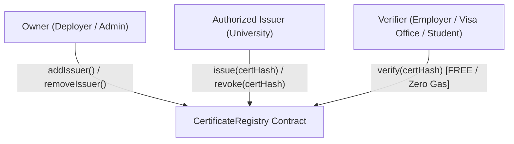
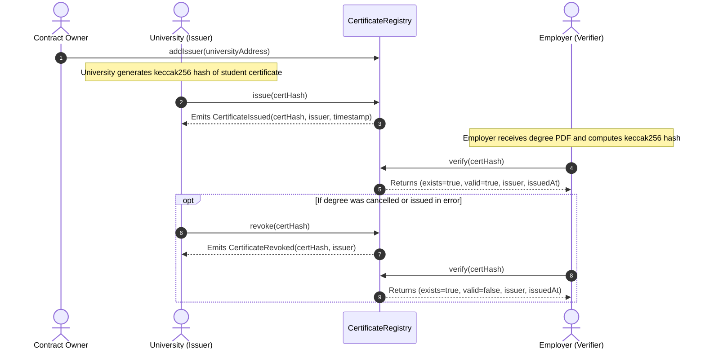

# CertiChain 🎓⛓️

**Academic Credential Verification on Ethereum**

CertiChain is a lightweight smart contract system built with **Solidity ^0.8.24** and **Foundry**. It enables accredited educational institutions to issue and revoke cryptographically verifiable degree certificates on-chain, allowing employers, universities, and visa offices to verify academic credentials instantly without contacting the issuing institution or compromising student privacy.

> Status: learning project. Deployed and tested on a local Anvil chain only. Not audited and not intended for production use.

---

## 📌 Table of Contents
- [The Problem & The Solution](#-the-problem--the-solution)
- [Why Blockchain vs. Traditional Database?](#-why-blockchain-vs-traditional-database)
- [System Architecture & Actors](#-system-architecture--actors)
- [Core Workflow](#-core-workflow)
- [Design Decisions](#-design-decisions)
- [Guarantees Enforced](#-guarantees-enforced)
- [Known Limitations](#-known-limitations)
- [Smart Contract API Reference](#-smart-contract-api-reference)
- [Getting Started & Local Development](#-getting-started--local-development)
  - [Prerequisites](#prerequisites)
  - [Build](#build)
  - [Running Unit Tests](#running-unit-tests)
  - [Test Coverage](#test-coverage)
  - [Local Deployment with Anvil & Forge Script](#local-deployment-with-anvil--forge-script)
  - [Interacting with Cast](#interacting-with-cast)
- [Project Directory Structure](#-project-directory-structure)

---

## 🛑 The Problem & The Solution

### The Problem
Employers, graduate schools, and visa offices regularly receive academic certificates (as PDFs, scanned images, or paper copies). Verifying whether these documents are authentic or forged currently requires:
- Cold emailing or calling college registrars.
- Paying expensive third-party background check agencies.
- Relying on trust, leaving the door wide open for credential fraud and diploma mills.

### The Solution: CertiChain
Instead of relying on slow, centralized manual checks:
1. The accredited university generates a cryptographic hash (`keccak256` fingerprint) of the graduate's certificate.
2. The university records this 32-byte hash on the Ethereum blockchain.
3. Anyone receiving a certificate simply hashes the file or details and calls the contract's `verify()` function.
4. In under a second, the verifier can check whether the document was officially issued, who issued it, when it was issued, and whether it has been revoked.

---

## 🏛️ Why Blockchain vs. Traditional Database?

| Feature | Centralized Database (e.g. AWS RDS, PostgreSQL) | Ethereum Smart Contract (CertiChain) |
|---|---|---|
| **Tamper Resistance** | A database administrator or compromised server can alter records or delete logs undetected. | Records cannot be silently edited or deleted; revocation is an explicit, logged action. |
| **Availability & Uptime** | Verification breaks if the university's database or API server is down or decommissioned. | Does not depend on a single institution's server. |
| **Trustless Verification** | The verifier must trust the integrity of the college's server and IT staff. | Rules are enforced by public, auditable contract code. |
| **Audit Trail** | Internal database audit logs can be wiped or modified. | **Public EVM Events**. Every issuance and revocation emits timestamped events on-chain. |

---

## 👥 System Architecture & Actors



1. **Owner (`owner`)**:
   - The address that deploys the contract (e.g., higher education consortium admin).
   - Manages authorized institutions via `addIssuer()` and `removeIssuer()`.
   - Can only issue certificates if it also authorizes itself as an issuer. Cannot revoke certificates issued by other institutions.
2. **Issuer (`isIssuer`)**:
   - An authorized educational institution (e.g., college or university wallet).
   - Can issue certificates (`issue()`) and revoke only the certificates it personally issued (`revoke()`).
3. **Verifier (Public)**:
   - Anyone (employers, embassies, students).
   - Queries `verify(certHash)` for free (zero gas via `eth_call`).

---

## 🔄 Core Workflow



---

## 💡 Design Decisions

Every line of `CertificateRegistry.sol` was deliberately designed for efficiency, security, and simplicity:

### 1. Hash-Only Storage (`bytes32 certHash`)
- **Privacy**: Avoids storing personal data on a public blockchain.
- **One-Way Cryptographic Fingerprint**: A `keccak256` hash is 32 bytes fixed length. Given the hash, an attacker cannot reverse-engineer student information. Yet, if even a single character in the certificate changes, the resulting hash is completely different.
- **Gas Efficiency**: Storing 32 bytes costs a single storage write (`SSTORE`), costing a fraction of the gas required to store dynamic strings or files.

### 2. EVM Storage Slot Packing (Gas Optimization)
Storage slots on the Ethereum Virtual Machine are 32 bytes (256 bits).
```solidity
struct Certificate {
    address issuer; // 20 bytes (160 bits)
    uint64 issuedAt; //  8 bytes ( 64 bits)
    bool revoked;    //  1 byte  (  8 bits)
}                    // Total: 29 bytes <= 32 bytes
```
- `address` (20 bytes) + `uint64` (8 bytes) + `bool` (1 byte) = **29 bytes**.
- Because 29 bytes, which is at most 32, the Solidity compiler packs the entire `Certificate` record into **one single 32-byte storage slot**.
- This saves an entire `SSTORE` operation, so issuing needs one storage write instead of several, and saves a second `SLOAD` on reads.
- `uint64` for timestamps will not overflow until the year **584,554,051,223 AD**, making it safe.

### 3. Immutable Owner
```solidity
address public immutable owner;
```
- The contract owner is established at deployment in `constructor()` and cannot be changed.
- Marking `owner` as `immutable` bakes the address directly into the contract bytecode at compile time, so reading the owner does not need a storage read when evaluating the `onlyOwner` modifier.

### 4. Custom Errors Instead of Require Strings
```solidity
error NotOwner();
error NotIssuer();
error ZeroHash();
error AlreadyIssued();
error NotFound();
error NotCertificateIssuer();
error AlreadyRevoked();
```
- Custom errors keep the contract smaller and reverts cheaper than long require strings.
- Custom errors encode to a compact 4-byte selector (`bytes4(keccak256("ErrorName()"))`), minimizing deployment cost and execution overhead.

### 5. Indexed Event Topics
```solidity
event CertificateIssued(bytes32 indexed certHash, address indexed issuer, uint64 issuedAt);
```
- Indexed parameters become indexed "topics" in EVM logs.
- Off-chain applications, frontend dApps, and indexers (e.g. The Graph, Etherscan) can query and filter logs directly by `certHash` or `issuer` without downloading and scanning the entire transaction history.

### 6. Zero External Dependencies (No OpenZeppelin)
- Access control (`onlyOwner`, `onlyIssuer`) is handwritten using elementary Solidity idioms.
- Keeps the contract self-contained, lightweight, and easy to read.

---

## 🛡️ Guarantees Enforced

1. **Only authorized issuers can register certificates**: Enforced by the `onlyIssuer` modifier on `issue()`.
2. **Only the original issuing institution can revoke a certificate**: University B cannot revoke degrees issued by University A. The owner cannot revoke them unless the owner is that issuer.
3. **No duplicate registrations**: Calling `issue()` with a previously registered hash reverts with `AlreadyIssued()`.
4. **No zero-hash certificates**: Submitting `bytes32(0)` reverts with `ZeroHash()`.
5. **No double revocation**: Revoking an already revoked certificate reverts with `AlreadyRevoked()`.
6. **Free public verification**: `verify()` is marked `external view`, meaning external RPC queries (`eth_call`) cost **0 gas**.

---

## ⚠️ Known Limitations

Real-world trade-offs and considerations:

1. **Proves registration, not trustworthiness**: the contract shows that address X registered hash Y at time Z, not that X is a real accredited institution. The owner decides who becomes an issuer.
2. **Guessable inputs**: hashes are public. If a certificate is built from predictable text (name, degree, year), someone could hash guesses and check them. A secret salt added before hashing would mitigate this.
3. **Hash squatting**: any authorized issuer can register any hash first, including one another institution would register.
4. **Removed issuers**: removing an issuer stops new issuance, but their existing certificates stay valid and they can still revoke them.
5. **Single owner**: no ownership transfer or recovery. Losing the owner key means no new issuers can be added. addIssuer also does not reject the zero address.
6. **No identity binding**: the contract verifies a document, not that the person presenting it is the person named on it.
7. **Local only**: tested and deployed on a local Anvil chain. Mainnet gas costs, key management and a user interface are out of scope.

---

## 📖 Smart Contract API Reference

### State Variables
| Name | Type | Visibility | Description |
|---|---|---|---|
| `owner` | `address` | `public immutable` | The contract deployer and administrator. |
| `isIssuer` | `mapping(address => bool)` | `public` | Returns `true` if an address is authorized to issue certificates. |

### Functions

#### `addIssuer(address issuer)`
- **Visibility**: `external`
- **Access**: `onlyOwner`
- **Description**: Grants `issuer` permission to issue and revoke certificates.
- **Emits**: `IssuerAdded(address indexed issuer)`

#### `removeIssuer(address issuer)`
- **Visibility**: `external`
- **Access**: `onlyOwner`
- **Description**: Revokes `issuer` authorization. (Previously issued certificates remain valid).
- **Emits**: `IssuerRemoved(address indexed issuer)`

#### `issue(bytes32 certHash)`
- **Visibility**: `external`
- **Access**: `onlyIssuer`
- **Description**: Stores the certificate hash, issuer address, and timestamp.
- **Reverts**: `ZeroHash` if `certHash == bytes32(0)`; `AlreadyIssued` if already registered.
- **Emits**: `CertificateIssued(bytes32 indexed certHash, address indexed issuer, uint64 issuedAt)`

#### `revoke(bytes32 certHash)`
- **Visibility**: `external`
- **Access**: Only the original issuer who issued `certHash`.
- **Description**: Sets `revoked = true` for an existing certificate.
- **Reverts**: `NotFound` if certificate does not exist; `NotCertificateIssuer` if caller is not original issuer; `AlreadyRevoked` if already revoked.
- **Emits**: `CertificateRevoked(bytes32 indexed certHash, address indexed issuer)`

#### `verify(bytes32 certHash)`
- **Visibility**: `external view`
- **Access**: Public (zero gas via `eth_call`)
- **Returns**:
  - `bool exists`: Whether the certificate was ever registered.
  - `bool valid`: True if `exists && !revoked`.
  - `address issuer`: Address of the issuing institution.
  - `uint64 issuedAt`: Block timestamp when the certificate was issued.

---

## 🚀 Getting Started & Local Development

### Prerequisites
- [Foundry](https://getfoundry.sh/) (`forge`, `anvil`, `cast`)
- Git

### Build
Compile the smart contracts with the pinned Solidity compiler (`0.8.24`):
```bash
forge build
```

### Running Unit Tests
Execute the comprehensive test suite (22 unit tests covering all edge cases):
```bash
forge test
```

For verbose output with gas reports:
```bash
forge test -vvv
```

### Test Coverage
Check test coverage (100% across lines, statements, branches, and functions):
```bash
forge coverage
```

```
╭-----------------------------+-----------------+-----------------+---------------+---------------╮
| File                        | % Lines         | % Statements    | % Branches    | % Funcs       |
+=================================================================================================+
| src/CertificateRegistry.sol | 100.00% (31/31) | 100.00% (29/29) | 100.00% (7/7) | 100.00% (8/8) |
|-----------------------------+-----------------+-----------------+---------------+---------------|
| Total                       | 100.00% (31/31) | 100.00% (29/29) | 100.00% (7/7) | 100.00% (8/8) |
╰-----------------------------+-----------------+-----------------+---------------+---------------╯
```

---

### Local Deployment with Anvil & Forge Script

1. **Start Anvil (local test node)**:
   ```bash
   anvil
   ```

2. **Deploy the contract using `DeployCertificateRegistry.s.sol`**:

   The private key below is Anvil's well-known public test key. Never use it on a real network.
   ```bash
   forge script script/DeployCertificateRegistry.s.sol:DeployCertificateRegistry \
     --rpc-url http://127.0.0.1:8545 \
     --broadcast \
     --private-key 0xac0974bec39a17e36ba4a6b4d238ff944bacb478cbed5efcae784d7bf4f2ff80
   ```

---

### Interacting with Cast

Once deployed, interact with the contract directly from your terminal using `cast`:

The commands below use bash syntax. In PowerShell, set variables with `$CONTRACT = "..."` and use `$CONTRACT` instead of `export`.
```bash
# Set environment variables for convenience
export CONTRACT="0x5FbDB2315678afecb367f032d93F642f64180aa3"
export RPC="http://127.0.0.1:8545"
export OWNER_KEY="0xac0974bec39a17e36ba4a6b4d238ff944bacb478cbed5efcae784d7bf4f2ff80"
export ISSUER_KEY="0x59c6995e998f97a5a0044966f0945389dc9e86dae88c7a8412f4603b6b78690d"
export ISSUER_ADDR="0x70997970C51812dc3A010C7d01b50e0d17dc79C8"

# 1. Authorize an institution as an issuer (called by Owner)
cast send $CONTRACT "addIssuer(address)" $ISSUER_ADDR \
  --rpc-url $RPC --private-key $OWNER_KEY

# 2. Compute a certificate hash (fingerprint)
CERT_HASH=$(cast keccak "Student: Alice | Degree: B.S. CS | Year: 2026")
echo $CERT_HASH

# 3. Issue the certificate (called by University Issuer)
cast send $CONTRACT "issue(bytes32)" $CERT_HASH \
  --rpc-url $RPC --private-key $ISSUER_KEY

# 4. Verify the certificate (Free view call by Verifier)
cast call $CONTRACT "verify(bytes32)(bool,bool,address,uint64)" $CERT_HASH \
  --rpc-url $RPC
# Returns:
# true                                          (exists)
# true                                          (valid)
# 0x70997970C51812dc3A010C7d01b50e0d17dc79C8  (issuer)
# 1793312866                                    (issuedAt)

# 5. Revoke the certificate (called by original Issuer)
cast send $CONTRACT "revoke(bytes32)" $CERT_HASH \
  --rpc-url $RPC --private-key $ISSUER_KEY

# 6. Re-verify the revoked certificate
cast call $CONTRACT "verify(bytes32)(bool,bool,address,uint64)" $CERT_HASH \
  --rpc-url $RPC
# Returns:
# true                                          (exists)
# false                                         (valid -> flagged revoked!)
# 0x70997970C51812dc3A010C7d01b50e0d17dc79C8  (issuer)
# 1793312866                                    (issuedAt)
```

---

## 📂 Project Directory Structure

```
certichain/
├── src/
│   └── CertificateRegistry.sol            # Core smart contract
├── test/
│   └── CertificateRegistry.t.sol          # 22 Foundry unit tests (100% coverage)
├── script/
│   └── DeployCertificateRegistry.s.sol    # Deployment script
├── foundry.toml                           # Foundry compiler & project settings
├── .gitignore                             # Git ignore rules for caches & keys
└── README.md                              # Documentation
```

---

## 📄 License
MIT License. Created for academic and educational purposes.
